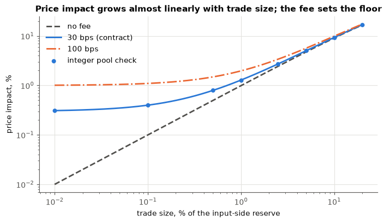
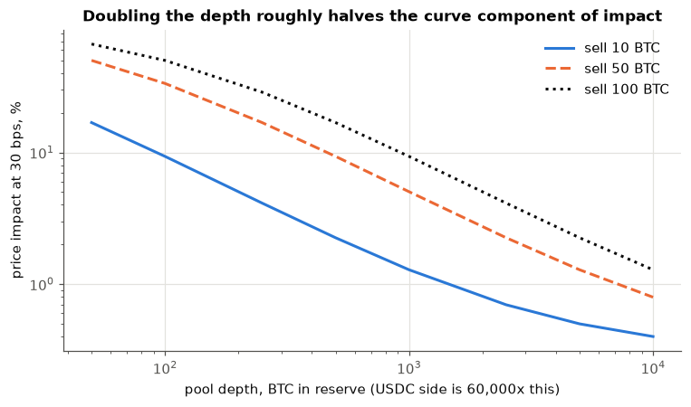
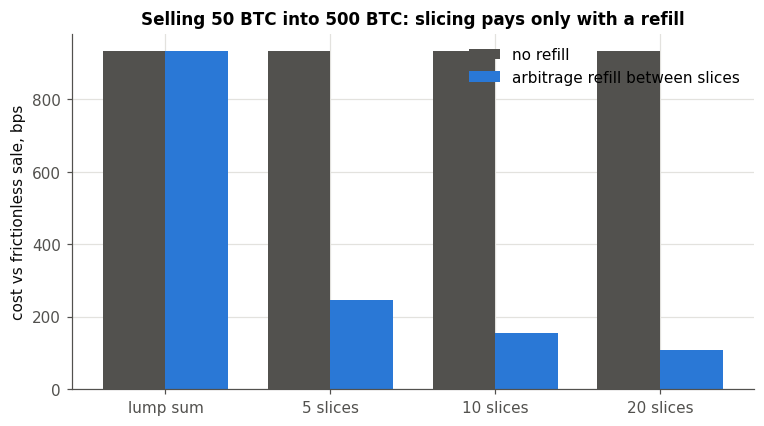
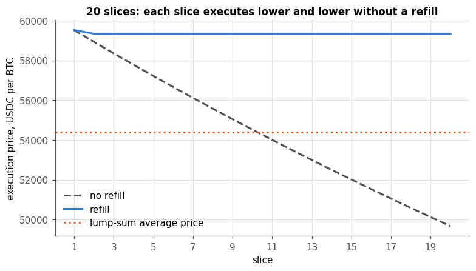
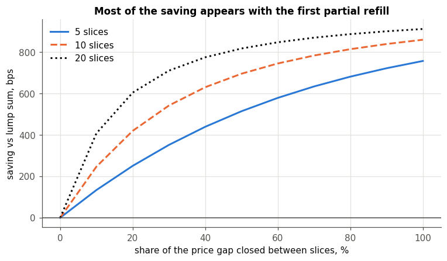
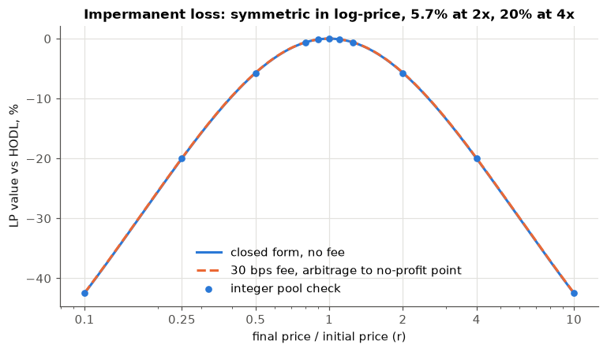
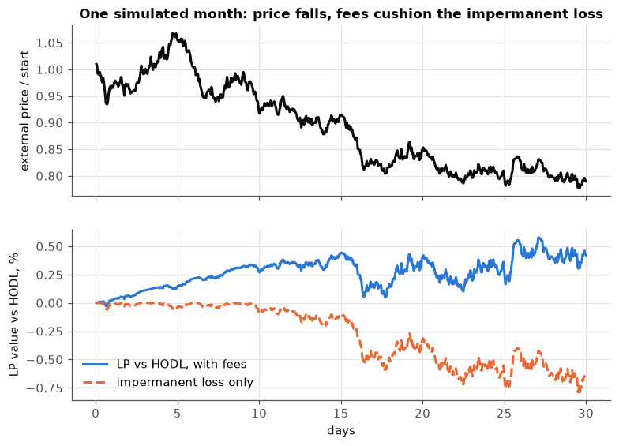
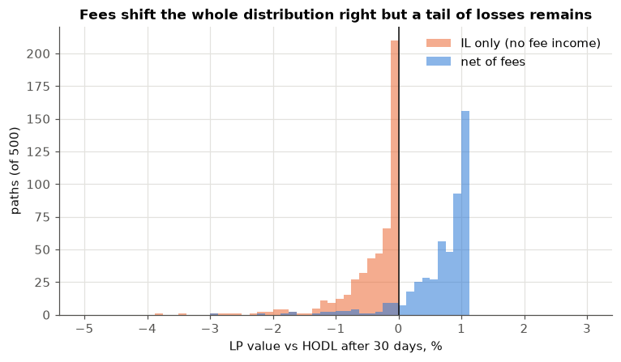
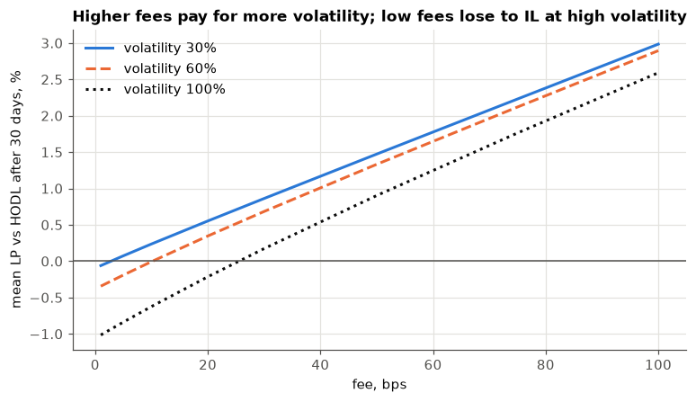
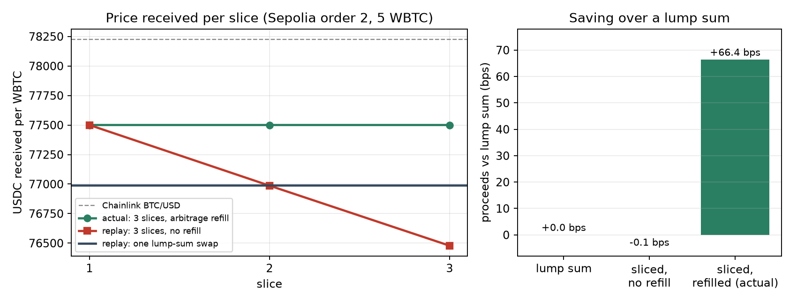

# Streaming-Order AMM

**FRE-GY 6931 Blockchain & Cryptocurrency, Fall 2026 · Topic 1: Automated Market Maker · Final project report**

Team: Aditya Shah (as22008), Siddhant Yadav (sy4583), Dev Salvi (ds8259)

Network: Ethereum Sepolia · Repository: https://github.com/M720d/Streaming-Order-AMM (tag `final`) · Video: linked in `submission.json`


## 1. Objective

Selling a large amount of a token into a constant-product pool is expensive: the price moves against the seller with every unit
sold, so the last coins sell far below the first. Selling 20 WBTC into a pool of 500 WBTC and 30 M USDC in one swap returns
1,150,517 USDC, 4.1% below what the same coins are worth at the pool's starting price, and most of that is price impact, not the
0.3% fee. The usual answer is to split the order. Splitting only helps, though, if someone puts the price back between the
pieces; otherwise each piece sells into the price the previous one left behind, and the total is the same as one big trade.

We built a small exchange that does the splitting for the seller and measured when it actually helps:

- a constant-product **Pool** for mock WBTC and USDC with a 30 bps fee, LP shares and a time-weighted average price;
- an **OrderBook** where a seller deposits the whole order once and receives an ERC-721 that owns it; the order is sold in a
  fixed number of equal slices, one per interval, by anyone who calls `executeSlice` (our keeper script does);
- a **PriceGuard** that reads Chainlink BTC/USD, refuses to trade on a stale, zero or carried-over price, and skips a slice when
  the pool has drifted too far from Chainlink;
- off-chain, a **keeper**, an **arbitrage bot** that refills the pool between slices, and a **web app** to create, watch, claim
  and cancel orders.

The research question is the one in the proposal: **how much does slicing save compared with a lump sum, and when does the
saving disappear?** Section 4 answers it with notebooks whose integer model reproduces the contracts exactly, and Part C adds
what the saving is worth after gas and whether a business could run on it. Everything runs on Ethereum's Sepolia testnet with
mock tokens (Section 3.5 lists the verified contracts); no real money is involved.


## 2. Design decisions

The system is four contracts on top of two test tokens: a constant-product `Pool` (also the LP share token), a `PriceGuard` that reads Chainlink BTC/USD, and an `OrderBook` that turns a large sell into an ERC-721 and executes it in equal slices. This section records the choices that shaped the contracts, what we considered, and what we changed after finding a problem.

### 2.1 One price unit across the system (changed during design)

*First idea.* Let the pool report its raw reserve ratio (raw USDC per raw WBTC, scaled by 1e18) and have the guard compare it with the oracle.

*Problem.* With WBTC at 8 decimals and USDC at 6, that ratio is 100 times smaller than the oracle's USD-per-BTC price (a pool at 60,000 USDC/BTC reports 6e17 where the oracle says 6e22). A guard comparing the two would reject every pool price, or accept a pool that is 100 times wrong, depending on which side was scaled.

*Decision.* Every price in the system is **USDC per one whole WBTC, scaled by 1e18** (60,000 USDC/BTC is `60_000e18`). The pool converts internally and raw-unit ratios never leave it. All remaining conversions on the order side (Chainlink's 8-decimal answer into this unit, and a WBTC amount into the raw USDC it is worth) live in one library, `PriceMath`, with its own tests, so there is a single place to audit. Interface functions carry the unit in their names (`spotPriceE18`, `consultTwapE18`, `poolWithinBounds(poolPriceE18)`).

### 2.2 Slicing: fixed count, equal slices, no dust

The slice count is a fixed integer (1 to 200) chosen at creation; there is no continuous TWAMM-style streaming. Each slice sells `total / slices`, and the **last slice sells everything that is left**, so rounding remainders are never stranded in the contract (tested with 10 WBTC + 3 raw units in 5 slices). The alternative, keeping dust and letting the seller sweep it, adds a state and a way to lose funds for no benefit.

*Timing.* The first slice is due one interval after creation. After every attempt, successful or skipped, the next one is due one interval **from now**, not one interval after the previous due time. We considered scheduling on a fixed grid, but a keeper that is late would then fire several slices back to back, which removes the refill time that slicing depends on (Section 4).

### 2.3 Oracle guard: skip when the pool is off, revert when the oracle is bad

Two different failures get two different behaviours.

- **Pool price outside the allowed band around the oracle** (default 5%, hard cap 20%): the slice is **skipped** with a `SliceSkipped` event, no tokens move, and the order tries again an interval later. Nothing is wrong with the order; the market is just temporarily off, and a revert would only waste the keeper's gas and hide the reason.
- **Oracle unusable** (price zero or negative, older than the staleness limit or dated in the future, or `answeredInRound` behind `roundId`): the call **reverts**. We cannot tell whether the pool is off, so trading blind is the one thing the guard must never do. This is the proposal's "no trading when the feed is stale".

The guard compares the pool's **spot** price with the oracle. We considered using the pool's own TWAP for the pool side, which resists single-block manipulation, but a TWAP lags and needs history that a young pool does not have. Spot against a fresh oracle is a tighter check at the moment of the trade, and the residual risk is covered by the minimum-output rule below.

### 2.4 Slippage: an oracle-derived minimum, per order

Each slice must return at least the oracle's quote for that slice minus the order's `toleranceBps` (capped at 10%), otherwise the pool call reverts. The seller chooses the tolerance. We learned two things from testing:

1. **Tolerance must cover the fee plus the accumulated drift.** An early test used 3% on a 10 WBTC order in five slices; the last slice reverted because, without a refill, it returned 116,365 USDC against a minimum of 116,400 (a 3.03% shortfall from the oracle quote of 120,000 for its 2 WBTC). We raised the test tolerance to 5% and wrote down the rule in the contract's NatSpec: tolerance has to cover the 30 bps fee plus the expected impact, or the slice reverts.
2. **Skip and revert coexist.** A slice that is too bad for the seller's tolerance reverts; it does not skip. The seller can always cancel.

**Known limitation.** A searcher can sandwich a slice. The attacker can push the pool price up to the guard band (5% by default) and the seller still receives at least the oracle quote minus tolerance, so the worst-case loss per slice is bounded by the tolerance and band the seller and owner chose, not unbounded. We did not add a private-mempool or commit-reveal scheme.

### 2.5 The order is an ERC-721 and its holder owns everything

The NFT holder owns the unsold WBTC and the USDC proceeds. `claim` pays the **current** `ownerOf`, so a transferred order pays its new holder (tested: slices run, the NFT moves, the new holder claims and the old one cannot cancel). Further choices:

- `claim` and `executeSlice` are callable by anyone, because the money can only go to the holder and a permissionless keeper is part of the design. `cancel` is **holder only**, not an approved operator, because it releases all funds and burns the NFT.
- `cancel` returns the unsold WBTC *and* any unclaimed USDC, deletes the order and burns the NFT. On a finished order it works as claim-and-burn.
- Minting uses `_safeMint` so contract wallets (multisigs, treasuries) can receive orders. That introduces a receiver callback, which is why every state-changing function is `nonReentrant` (tested by a receiver that tries to cancel during the mint, and a pool that calls back during the swap).

### 2.6 Trust and admin surface kept as small as possible

- `OrderBook` and `Pool` have **no owner and no admin function**. The pool and guard addresses are immutable.
- `PriceGuard` has one owner who can change exactly two numbers: the staleness limit (1 second to 1 day) and the deviation band (1 to 2,000 bps). Both have hard caps, emit events, and zero is rejected so a mistake cannot brick the guard. The owner cannot change the feed or touch funds. The same list is in the contract's NatSpec.
- The `OrderBook` approves the pool for exactly the slice amount before each swap. We considered a one-time unlimited approval, which saves an estimated 20k gas per slice (not measured), and rejected it: it would expose every order's WBTC to the pool address if the pool ever had a bug.

### 2.7 Gas: one change that worked, one that did not

`createOrder`, `executeSlice`, `claim` and `cancel` were measured before and after (`docs/gas-orders.md`). The order struct in the interface needs three storage slots only because the 16-bit tolerance spills over. Keeping the interface unchanged but storing the order in two slots (narrowing the slice size to 96 bits, about 1e13 times the WBTC supply, and rejecting anything larger) saves **22,054 gas on `createOrder`** (11.9%), 1,986 on each slice and 4,005 on `cancel`. Our first attempt, caching the order in memory inside `executeSlice`, made it **924 gas worse** and was reverted.

### 2.8 What we did not build, and one deliberate difference from the proposal

- **Execution fee and protocol share of the swap fee.** The proposal's revenue model has both. We did not build them: the contracts
  charge nothing beyond the pool's 30 bps, which goes entirely to LPs, so **as built the protocol earns nothing**. We treated both
  as future work rather than change tested contracts days before the deadline. Sections 4.7, 6.4 and 7 say what that means for the
  business.
- **Early-LP rewards paid in the share token** (the proposal's plan for the first hundred users) are not built; that needs a reward
  contract (Section 6.3).
- **The LP token is the `Pool` contract itself**, not a separate ERC-20 as the proposal's contract table listed. That is one contract
  fewer to deploy and review, and share accounting and reserves change in the same call. The cost is that the pool's address is also
  the token's address, so the pool cannot be replaced while keeping the same token. Nothing in the tests depends on the choice.
- The keeper, the arbitrage bot and the front end are described in Section 3.4.

### 2.9 What changed because we ran it on Sepolia

- **Staleness limit 3,600 s became 7,200 s.** Chainlink's Sepolia BTC/USD feed updated at 20:44 and 21:44 UTC on 2026-11-01, so it
  updates hourly and its age cycles between zero and one hour. A one-hour limit would make slices revert near the end of each
  cycle. The owner can raise the limit up to the hard cap of one day.
- **Arbitrage threshold 50 bps became 35 bps.** A first live order (1 WBTC in three slices) moved the pool only 39 bps from
  Chainlink, so a 50 bps bot never traded. The pool fee is 30 bps, so 35 is about the smallest threshold that can still pay.
- **Front-end reads.** Alchemy's free tier allows `eth_getLogs` over only 10 blocks, so order discovery starts at the deploy block
  and Sepolia reads go through a public RPC with Alchemy as the fallback. The Chainlink feed address is read from
  `PriceGuard.feed()` instead of looking up the local-only mock aggregator.
- **Gas.** Actions that create storage cost 2 to 4 times more gas on Sepolia than in our local tests, and contract creation about
  7 times more (Section 5.3). Our first cost estimates assumed they would match.


## 3. Architecture

### 3.1 Contracts and how they connect

The system is six contracts on Sepolia: two test tokens, a pool, an oracle guard, an order book, and Chainlink's BTC/USD feed, which we read but do not own.

```
             seller / keeper
                  |
                  v
   +------------------------------+     reads     +--------------------+
   |   OrderBook (ERC-721)        |-------------->|    PriceGuard      |----> Chainlink BTC/USD
   |   one NFT per streaming order|  is the pool  |  staleness, sign,  |      (Sepolia feed)
   +------------------------------+  price within |  deviation checks  |
                  | swapExactIn     limits?       +--------------------+
                  v                                        ^
   +------------------------------+   spotPriceE18()       |
   |   Pool  (x*y = k, 30 bps)    |------------------------+
   |   is also the LP share token |   consultTwapE18() (any reader)
   +------------------------------+
        ^                    ^
        | LPs: addLiquidity  | traders: swapExactIn
        |  removeLiquidity   |
   +----------+        +----------+
   | MockWBTC |        | MockUSDC |   token0 = WBTC (8 decimals), token1 = USDC (6 decimals)
   +----------+        +----------+
```

The pool is the only contract that holds liquidity and the only one that sets prices. The order book never computes a price itself; it asks the pool for a swap and asks the guard whether the pool's price is acceptable. Section 3.3 covers the order side.

### 3.2 The pool-side contracts

**MockWBTC and MockUSDC** are test tokens (OpenZeppelin ERC-20) with 8 and 6 decimals, matching the real assets. Sepolia has a BTC/USD price feed but no liquid WBTC/USDC market, so we issue our own pair. Each has an owner-only `mint` and a public `faucet(amount)` capped per call (5 WBTC, 500,000 USDC) so teammates can fund themselves without asking the owner. These are the only owner powers in the pool-side contracts, and they exist for testing only.

**Pool** is a constant-product pool for the pair, and it is also the ERC-20 that represents LP shares (symbol `SALP`). Everything a liquidity provider or trader does goes through five functions:

| Function | What it does |
|---|---|
| `addLiquidity(a0Desired, a1Desired, a0Min, a1Min, to)` | Takes tokens in the pool's current ratio (never less than the minimums) and mints shares to `to`. The first deposit mints `sqrt(a0 * a1) - 1000` shares and locks 1000 forever, so the pool can never be emptied and the price stays defined. |
| `removeLiquidity(shares, a0Min, a1Min, to)` | Burns the caller's shares and sends the matching share of both reserves to `to`. |
| `swapExactIn(tokenIn, amountIn, minAmountOut, to)` | Sells an exact amount in, reverts with `SlippageExceeded` if the output is below `minAmountOut`. The 30 bps fee is deducted from the input and stays in the reserves, so it accrues to LPs and `k` grows on every trade. |
| `spotPriceE18()` | Current price, USDC per whole WBTC, scaled by 1e18 (60,000 USDC/BTC reads as `60_000e18`). |
| `consultTwapE18(window)` | Time-weighted average of that price over the last `window` seconds. |

Design points specific to the pool:

- **Integer maths only, floor division.** The swap formula is `out = in*9970 * reserveOut / (reserveIn*10000 + in*9970)`. Because there is no floating point, the Python model in `docs/analysis_pool.ipynb` reproduces every contract output exactly, and the Hardhat tests assert values computed in Python rather than values read back from the contract.
- **TWAP from the pool's own accumulator.** On every reserve change the pool adds `price * seconds elapsed` to a running total and records `(timestamp, total)`. `consultTwapE18` finds the record at the start of the window, interpolates to the exact start using the price that was in force then, and divides the difference by the window. Records are stored once per block timestamp, packed into one 256-bit slot. A window longer than the pool's age reverts with `InsufficientHistory` instead of returning a biased number.
- **No admin.** The pool has no owner, no pause, no upgrade path and no fee switch. The fee is a constant. Nothing in it can be changed after deployment.
- **One price unit.** The pool reads both tokens' decimals at construction and converts internally, so the raw reserve ratio never leaves the contract (Section 2.1 explains why this mattered).
- **Reserves and update time share one storage slot** (112 + 112 + 32 bits). This is the gas optimization in Section 5.3; it caps each reserve at about 5.2e33 raw units, enforced with a checked cast.

**What the pool does not support:** fee-on-transfer and rebasing tokens (it credits the amount it asked for), and ERC-777-style token callbacks. Both tokens here are our own plain ERC-20s.

### 3.3 The order-side contracts

**OrderBook** is an ERC-721 (`SORDER`) with no owner. Every order is one NFT; its holder owns the unsold WBTC and the USDC proceeds.

| Function | What it does |
|---|---|
| `createOrder(totalIn, slices, interval, toleranceBps)` | Pulls `totalIn` WBTC from the caller (needs an approval), stores the order and mints the NFT. Slices 1 to 200, tolerance at most 10%. |
| `executeSlice(orderId)` | Callable by anyone once the interval has elapsed. Asks PriceGuard whether the pool is inside the band; if not, emits `SliceSkipped` and retries one interval later. Otherwise sells `total / slices` (the last slice sells everything left) through `Pool.swapExactIn`, with a minimum output of the oracle's quote minus the order's tolerance. |
| `claim(orderId)` | Pays the accumulated USDC to the current NFT holder. |
| `cancel(orderId)` | Holder only. Returns the unsold WBTC and any unclaimed USDC and burns the NFT. |
| `getOrder(orderId)` | View: remaining amount, proceeds, slice size, slices left, interval, next execution time, tolerance. |

Every state-changing function is `nonReentrant`, all transfers use SafeERC20, and the pool is approved for exactly the slice amount
before each swap.

**PriceGuard** reads Chainlink and answers one question for the order book.

| Function | What it does |
|---|---|
| `getOraclePrice()` | Returns the BTC/USD price in the system's price unit (USDC per WBTC, 1e18). Reverts if the answer is zero or negative, older than `maxStaleness`, dated in the future, or from a carried-over round (`answeredInRound < roundId`). |
| `poolWithinBounds(poolPriceE18)` | True when the pool price is within `maxDeviationBps` of the oracle price. |
| `setMaxStaleness`, `setMaxDeviationBps` | **The only admin functions in the whole system.** Owner only, hard-capped (1 s to 1 day; 1 to 2,000 bps), emit events. The owner cannot change the feed or touch funds. |

### 3.4 Off-chain components

- **Keeper** (`packages/hardhat/scripts/keeper.ts`). Finds orders from `OrderCreated` events and, for each order whose interval has
  elapsed, simulates `executeSlice` first and sends it only if the simulation would execute. It sends one transaction at a time,
  never re-sends a transaction that is still pending, and logs `filled`, `skipped` or `reverted` with the transaction hash.
- **Arbitrage bot** (`scripts/arb.ts`). Reads the Chainlink price and the pool price. When the gap exceeds a threshold it sizes the
  profit-maximising trade (the same rule as the analysis notebook), caps it by a maximum size and the wallet balance, and trades only
  if the expected profit after the 30 bps fee is above a minimum. It approves exactly the amount it trades. This is what refills the
  pool between slices.
- **Front end** (`packages/nextjs`, Scaffold-ETH 2). Pool and oracle view, a create-order form with a lump-sum versus sliced
  preview and a confirmation step that lists what the user will sign, order progress, claim and cancel, transaction status, plain
  language error messages, and a warning when the Chainlink feed is stale.
- **Tooling.** `yarn fund-arb`, `yarn send-eth` and `yarn evidence` (a read-only script that lists deploy and first-event
  transactions with gas); the run-book is `docs/sepolia-runbook.md`.

### 3.5 Address table (Sepolia, all verified on Etherscan)

| Contract | Role | Address (source verified) | Deployment tx |
|---|---|---|---|
| MockWBTC | Test token, 8 decimals, capped faucet | [`0x2c95a78b3a3fc73c16bdd6394bfe30cc51d37d12`](https://sepolia.etherscan.io/address/0x2c95a78b3a3fc73c16bdd6394bfe30cc51d37d12#code) | [`0x688d1fd6...`](https://sepolia.etherscan.io/tx/0x688d1fd66089f0b4403d7b5b0bdefd9d6438755058c0497c8b1a896ba38a9713) |
| MockUSDC | Test token, 6 decimals, capped faucet | [`0x9cd5587b22d15790a5880d37837cdd091c9ea0b5`](https://sepolia.etherscan.io/address/0x9cd5587b22d15790a5880d37837cdd091c9ea0b5#code) | [`0xae7c03dc...`](https://sepolia.etherscan.io/tx/0xae7c03dc001999a316843c1422e1adb8d5a8c77671a827d4c232e13f8d108c30) |
| Pool | Constant-product pool, 30 bps, TWAP; **also the ERC-20 LP token `SALP`** | [`0x9461fd23335242663ddf7a9fae994995df7fc8e9`](https://sepolia.etherscan.io/address/0x9461fd23335242663ddf7a9fae994995df7fc8e9#code) | [`0xa9f51895...`](https://sepolia.etherscan.io/tx/0xa9f518956712c252595a1c82f20f3f5135a4b7899a7967472d8258ae03ea0fd5) |
| PriceGuard | Chainlink checks and pool deviation band | [`0xe52d276bec7b96bcdd0632050cad5717956289df`](https://sepolia.etherscan.io/address/0xe52d276bec7b96bcdd0632050cad5717956289df#code) | [`0xe52450a3...`](https://sepolia.etherscan.io/tx/0xe52450a33066410a53cacb31113b19f987abd3738f4bb12ab25dd62cc9f2c026) |
| OrderBook | **ERC-721 `SORDER`**, streaming orders | [`0x9c20dbb0bb17a0532348e69502af3b8b44fefa62`](https://sepolia.etherscan.io/address/0x9c20dbb0bb17a0532348e69502af3b8b44fefa62#code) | [`0xbb0acbd1...`](https://sepolia.etherscan.io/tx/0xbb0acbd1e5668e3ad448a76b1b50f65c6d3e0c558ba36da19733dd5757385572) |
| Chainlink BTC/USD feed (external) | Price oracle, 8 decimals | [`0x1b44F3514812d835EB1BDB0acB33d3fA3351Ee43`](https://sepolia.etherscan.io/address/0x1b44F3514812d835EB1BDB0acB33d3fA3351Ee43) | n/a |

The tokens we mint are the **SALP** ERC-20 (LP shares, minted by `Pool.addLiquidity`) and the **SORDER** ERC-721 (one per order,
minted by `OrderBook.createOrder`); both are used by the application. Seed liquidity: [`0xf2bea583...`](https://sepolia.etherscan.io/tx/0xf2bea583b5a9303af541ff6593d586d98daba0ece865954d11fd89272098e828).


## 4. Financial analysis

Two notebooks answer one question: how much does slicing a large order save compared with selling it at once, and when does the saving disappear? `docs/analysis_pool.ipynb` (Part A) covers the pool; `docs/analysis_slicing.ipynb` (Part B) covers slicing. Both use the contract's integer arithmetic (30 bps fee taken from the input and left in the reserves, floor division), so each number below is what the contracts compute. Starting pool: 500 WBTC and 30,000,000 USDC (60,000 USDC per WBTC), as in the proposal.

### 4.1 Price impact by trade size (Part A)

| Trade (WBTC) | % of reserve | Impact, 30 bps fee | Impact, no fee |
|---:|---:|---:|---:|
| 0.05 | 0.01% | 0.31% | 0.01% |
| 2.5 | 0.5% | 0.79% | 0.50% |
| 12.5 | 2.5% | 2.72% | 2.44% |
| 50 | 10% | 9.34% | 9.09% |
| 100 | 20% | 16.88% | 16.67% |

Impact is driven by the trade as a share of the reserve. The proposal's figures (about 9% for 50 BTC, about 0.5% for a 2.5 BTC slice) are the no-fee column; with the 30 bps fee they are 9.3% and 0.8%. A 50 BTC sale costs 9.3% in a 500 BTC pool and 1.3% in a 5,000 BTC pool.




<p class="cap">Figure 1. Price impact grows almost linearly with trade size; the fee sets the floor.</p>



<p class="cap">Figure 2. Doubling the depth roughly halves the curve component of impact.</p>

### 4.2 Lump sum versus 5, 10 and 20 slices (Part B)

Selling 50 WBTC (10% of the pool), cost measured against the frictionless value 50 x 60,000 USDC:

| Strategy | Proceeds (USDC) | Cost vs frictionless | Saving vs lump sum |
|---|---:|---:|---:|
| Lump sum | 2,719,832.68 | 934 bps | n/a |
| 5 slices, no refill | 2,719,547.22 | 935 bps | -1.05 bps |
| 10 slices, no refill | 2,719,510.48 | 935 bps | -1.18 bps |
| 20 slices, no refill | 2,719,492.02 | 935 bps | -1.25 bps |
| 5 slices, refill | 2,925,696.22 | 248 bps | +757 bps |
| 10 slices, refill | 2,953,598.46 | 155 bps | +859 bps |
| 20 slices, refill | 2,967,746.04 | 108 bps | +912 bps |

"Refill" means an arbitrageur restores the pool to its no-profit price at the external price between slices, at no cost to the seller.

**Without a refill, slicing does not help.** The pool depends only on how much WBTC is in the reserve, not on how it arrived, so the price ends in the same place. With zero fee the sliced and lump outputs differ by a few raw units of rounding (-1, -3 and -9 raw USDC for 5, 10 and 20 slices). With the 30 bps fee the slices are 1.05 to 1.25 bps *worse*, because each slice's fee stays in the reserve and worsens the next slice's price.

**With a refill, slicing saves a lot, with diminishing returns:** 757, 859 and 912 bps for 5, 10 and 20 slices (about 9% of proceeds at 20).



<p class="cap">Figure 3. Selling 50 BTC into 500 BTC: slicing pays only with a refill.</p>



<p class="cap">Figure 4. 20 slices: each slice executes lower and lower without a refill.</p>

**The saving does not vanish gradually.** Letting `rho` be the share of the price gap that is closed between slices:

| Gap closed per slice | Saving, 5 slices | Saving, 20 slices |
|---:|---:|---:|
| 0.1% | 0.4 bps | 4.6 bps |
| 1% | 13 bps | 56 bps |
| 10% | 133 bps | 407 bps |
| 50% | 514 bps | 817 bps |
| 100% | 757 bps | 912 bps |

The curve is steep at first and then flattens: 10% of the refill already gives 45% of the 20-slice saving. The saving disappears only when almost nothing refills the pool between slices. The slice interval matters through this share, because a longer interval gives arbitrageurs time to act. The notebook uses the refill share as a stand-in for the interval; the Sepolia order in Section 4.5 shows one real case, in which the arbitrage bot, polled about every 20 seconds, restored the pool to within the fee band of Chainlink before every slice.



<p class="cap">Figure 5. Most of the saving appears with the first partial refill.</p>

**Depth and fee (20 slices, full refill, saving vs lump sum):** 4,581 bps in a 100 BTC pool, 912 bps at 500 BTC, 161 bps at 2,500 BTC; at 500 BTC the fee changes it only from 945 bps (no fee) to 833 bps (100 bps fee). Slicing saves curve impact, not fees, so the fee barely matters, but pool depth decides how much there is to save.

### 4.3 Interaction with the oracle guard

Without a refill, the 5% guard first skips at **slice 7 of 20**, and slice 20 would need 1,720 bps of tolerance, above the 1,000 bps cap. So a 50 BTC order in 20 slices **cannot finish without a refill, whatever tolerance the seller sets**. This is the guard working as intended, and it is why the demo uses our own arbitrage script to refill the thin Sepolia pool.

### 4.4 Impermanent loss and LP profit (Part A)

Impermanent loss depends only on the price move `r`: 5.72% at 2x or 0.5x, 20.0% at 4x, 42.5% at 10x, matching the closed form `2*sqrt(r)/(1+r) - 1` exactly in the integer pool. The 30 bps fee opens a no-trade band of about +/-0.3% around the start price and otherwise trims the loss by only 0.04 to 0.06 points (5.72% becomes 5.68% at 2x). Over a simulated 30-day path in the base case, fees average 1.07% of TVL against a mean IL of 0.38%, so the LP ends on average 0.68% ahead of simply holding and beats holding on 91.6% of paths. The break-even organic volume that covers expected IL is about 0.4%, 2.4% and 8.1% of TVL per day at 30%, 60% and 100% volatility. This is Part A's result; see the notebook for assumptions (price path, volume model, arbitrage timing).



<p class="cap">Figure 6. Impermanent loss is symmetric in log-price: 5.7% at 2x, 20% at 4x.</p>



<p class="cap">Figure 7. One simulated month: price falls, fees cushion the impermanent loss.</p>



<p class="cap">Figure 8. Fees shift the whole distribution of LP results right, but a tail of losses remains.</p>



<p class="cap">Figure 9. Higher fees pay for more volatility; low fees lose to IL at high volatility.</p>

### 4.5 Reconciliation: model versus contracts

- **Local, done.** `scripts/exportSliceFixture.ts` runs the real `Pool`, `PriceGuard` and `OrderBook` on a local chain: a 20 WBTC order in 5 slices with and without refill, and the same 20 WBTC as one swap. The notebook rebuilds every slice amount, slice output, reserve after each slice, arbitrage trade and total from the starting reserves, and asserts equality: **56 comparisons, all exactly equal** (lump sum 1,150,517,367,388 raw USDC; 5 slices no refill 1,150,465,094,696; with refill 1,184,117,434,876).
- **Sepolia, done: 3 of 3 slices exactly equal.** Order 2 sold 5 WBTC in three slices (60 s apart, 3% tolerance). It was created from
  the web app and its slices were executed by our keeper script, with our arbitrage bot refilling the pool between them. For each
  `executeSlice` transaction, section 5 of `docs/analysis_slicing.ipynb` reads the `SliceExecuted` event and the pool reserves at the
  block before it, applies the integer swap formula, and asserts that the model's output equals the chain's. The reads are bundled in
  `docs/data/sepolia_order2_slices.json` so the notebook runs offline, and the cell reads the chain live when `SEPOLIA_RPC_URL` is set.

| Slice | Transaction | Reserves before (raw WBTC / raw USDC) | Slice in (raw WBTC) | Model output = chain output (raw USDC) |
|---|---|---|---:|---:|
| 1 | [`0x5e2d5767...`](https://sepolia.etherscan.io/tx/0x5e2d57674c0b396c4c36d080436d7d655d7cc986467b3a595591e76c3f63afa7) | 49,906,524,485 / 38,923,228,585,325 | 166,666,666 | 129,167,076,412 (equal) |
| 2 | [`0xb3ba7ea0...`](https://sepolia.etherscan.io/tx/0xb3ba7ea07ecbee1d9ed18f651070cb568143cf43b1d73827bb78ef25c27ac942) | 49,907,026,754 / 38,923,614,180,343 | 166,666,666 | 129,167,060,363 (equal) |
| 3 | [`0x24a0d1fa...`](https://sepolia.etherscan.io/tx/0x24a0d1fae617dd5ddd4482a2e74e3875eddd3df0a4de36f908a9c35700fe297c) | 49,907,525,091 / 38,924,002,850,533 | 166,666,668 | 129,167,066,208 (equal) |

What the order earned, compared with the same 5 WBTC sold at once from the pool state before slice 1 (the last two rows are model
replays from that state, not other transactions):

| Strategy | Proceeds (USDC) | vs lump sum |
|---|---:|---:|
| One lump-sum swap (replay) | 384,946.34 | n/a |
| Three slices, no refill (replay) | 384,942.53 | -0.1 bps |
| **Three slices with the arbitrage refill (actual, on chain)** | **387,501.20** | **+66.4 bps (+2,554.87 USDC)** |



<p class="cap">Figure 10. Sepolia order 2. Left: price received per WBTC for each slice. Right: proceeds against a lump sum.</p>

This is the central claim of the project on a real network: slicing helped only because something refilled the pool (the no-refill
replay is slightly *worse* than a lump sum), and the model predicted each slice to the last unit. One order is one data point: the
Chainlink price rose between seeding the pool and the order, and the +66 bps depends on this pool's depth (about 500 WBTC for a 5 WBTC order).

### 4.6 What the model leaves out

Gas and keeper costs (measured separately in `docs/gas-orders.md`: about 160k to 200k gas per slice locally and about 510k on Sepolia; Section 5.3), the cost of the arbitrage that provides the refill and the competition for it, MEV on the slices (Section 2.4), a changing external price during the order (held constant here), correlation between volume and volatility, and a protocol fee. The break-even volume for protocol revenue promised in the proposal is **not estimated** because the fee is not implemented. All of these would make real outcomes worse than the numbers above.

### 4.7 Cost per user action and break-even (Part C)

**Assumptions, stated once.** Gas price 10 gwei on Ethereum L1, ETH at $3,000, BTC at $60,000. These are round assumptions,
not observations; the notebook shows 1 to 50 gwei and $2,000 to $5,000. An "L2-like" column at 0.05 gwei shows how much of
the cost is the chain rather than the design (rollup data fees are ignored). Gas was measured on a local Hardhat chain with
the deployed compiler settings; **the Sepolia deployment contradicts the assumption that other networks cost the same.** Measured on Sepolia
(2026-11-01, `docs/data/evidence_sepolia.json`): contract creation used about 7x the gas of our local figures (Pool 12.0M, OrderBook
15.7M, PriceGuard 3.9M, each mock token 4.2M; locally the three order-side contracts took 4.63M in total), a first-time
`approve` estimates at 129,365 gas against 46,353 locally, and the seed `addLiquidity` used 925,874. The cause is not verified (new
storage appears to be priced higher on that network). We therefore show both columns below and did not recompute every USD table. The USD figures below are therefore lower bounds for Sepolia-like pricing.

Measured on Sepolia (rehearsal order, 1 WBTC in 3 slices, 2026-11-01), against the local figures used in the table below:

| Action | Local gas | Sepolia gas | Ratio |
|---|---:|---:|---:|
| Approve WBTC (exact amount) | 46,353 | 128,273 | 2.8x |
| `createOrder` | 158,734 | 608,006 | 3.8x |
| `executeSlice` (first slice) | 190,399 | 509,033 | 2.7x |
| `swapExactIn` (arbitrage refill) | 117,775 | 234,251 | 2.0x |
| `claim` | 56,705 | 60,164 | 1.1x |

Actions that create new storage cost far more there; `claim`, which only updates existing storage, barely changes. One order each, so treat the ratios as indicative. The one-off deployment figure further down (4.63 M gas) is a local figure; on Sepolia the same three contracts used 31.7 M.

**What each action costs.**

| Who pays | Action | Gas | USD at 10 gwei | USD at 50 gwei | USD, L2-like |
|---|---|---:|---:|---:|---:|
| Seller | Approve WBTC (exact amount) | 46,353 | 1.39 | 6.95 | 0.007 |
| Seller | `createOrder` | 158,734 | 4.76 | 23.81 | 0.024 |
| Seller | `claim` | 56,705 | 1.70 | 8.51 | 0.009 |
| Seller | `cancel` (unfilled) | 56,148 | 1.68 | 8.42 | 0.008 |
| Keeper | `executeSlice` (mean of 4) | 163,545 | 4.91 | 24.53 | 0.025 |
| Keeper | `executeSlice` (first slice, worst case) | 190,399 | 5.71 | 28.56 | 0.029 |
| Trader / arbitrageur | `swapExactIn` | 117,775 | 3.53 | 17.67 | 0.018 |
| LP | `addLiquidity` (existing LP) | 123,548 | 3.71 | 18.53 | 0.019 |
| LP | `removeLiquidity` | 111,431 | 3.34 | 16.71 | 0.017 |

A full 10-slice order (approve, create, 10 slices, claim) is 1,897,242 gas: **$56.92** at 10 gwei and $3,000, from $3.79
(1 gwei, $2,000) to $474 (50 gwei, $5,000). The seller pays about $7.85 of that; the keeper pays the other $49.06.
Deploying Pool, PriceGuard and OrderBook is 4.63 M gas, $139 once. Our numbers agree with the before/after tables in
`gas-orders.md` and `gas-pool.md` to within a few percent; the differences come from account state, not the code.

**Does slicing still pay after the keeper's gas?** In the 500 WBTC / 30 M USDC pool, assuming arbitrage fully refills the
pool between slices (the best case; Section 4.2 shows how partial refill shrinks it):

| Order | Slices | Saving vs lump sum, before gas | Keeper gas (10 gwei) | Net saving | Net, bps of order |
|---|---:|---:|---:|---:|---:|
| 1 WBTC ($60k) | 10 | $107 | $49 | $58 | 9.7 |
| 1 WBTC ($60k) | 20 | $113 | $98 | $15 | 2.5 |
| 5 WBTC ($300k) | 10 | $2,655 | $49 | $2,606 | 86.9 |
| 20 WBTC ($1.2M) | 10 | $41,130 | $49 | $41,081 | 342.3 |
| 50 WBTC ($3M) | 20 | $256,331 | $98 | $256,233 | 854.1 |

Price impact grows with the square of the order's share of the pool, while the keeper's cost grows only with the number of
slices. So gas only decides the question for small orders: on L1, slicing into 10 beats a lump sum from about **0.7 WBTC at
10 gwei** (1.6 WBTC at 50 gwei, 0.1 WBTC on an L2-like chain). Below that, more slices make it worse, not better. A cross-check
against the real contracts: the end-to-end test's 20 WBTC, 5-slice order with our real arbitrage bot earned 292 bps over the
lump sum, just under the model's full-refill ceiling of 303 bps for the same order.

**Break-even for going to market.** The proposal's revenue model has two parts, and **neither is built** (the contracts
charge no execution fee and pay the whole 30 bps swap fee to LPs):

- a protocol share of the swap fee, assumed **5 of the 30 bps** (LPs keep 25), earned on the streaming volume and on the
  arbitrage volume that refills it (about equal to it: one refill per slice in our test);
- an **execution fee of 10 bps** of each order's notional, which also pays the keeper's gas.

Fixed costs per month, assumed: RPC $50, keeper and bot server $20, front-end hosting $20, monitoring $25, and an external
audit of $40,000 amortised over 24 months ($1,667): **$1,782 in total**, no salaries. A second scenario adds one part-time
engineer at $5,000 ($6,782).

| Average order | Slices | Chain | Orders per month to break even | Streaming volume per month |
|---|---:|---|---:|---:|
| $50,000 | 10 | L1, 10 gwei | 35 | $1.75 M |
| $50,000 | 20 | L1, 10 gwei | 952 | $47.6 M |
| $50,000 | 10 | L1, 50 gwei | never (gas exceeds the fee) | never |
| **$250,000** | **10** | **L1, 10 gwei** | **4** | **$1.0 M** |
| $250,000 | 20 | L1, 50 gwei | 191 | $47.8 M |
| $250,000 | 10 | L2-like | 4 | $1.0 M |
| $1,000,000 | 10 | L1, 10 gwei | 1 | $1.0 M |

With one part-time engineer the base case ($250k, 10 slices, 10 gwei) needs **16 orders and $4.0 M a month**.

Three conclusions. First, **as built the protocol never breaks even**: it earns nothing, and someone (us, or a volunteer keeper)
pays about $5 of gas per slice on L1. The execution fee is not optional for a real launch. Second, the business only works for
**large orders**, which is also where slicing saves the most: a $250k order saves the seller tens to hundreds of bps and costs
the seller only the 10 bps execution fee on top of the 30 bps swap fee it pays anyway. The protocol earns 20 bps of the order
($500): the execution fee plus its 5 bps cut of the swap fee on the order and on the arbitrage trades that refill it, both
taken out of the LPs' 30 bps, not added to it. Small orders on a busy L1 lose money for the
operator because 10 to 20 keeper transactions cost more than the fee; a minimum order size, or a per-slice fee floor, fixes that.
Third, the levers are roughly equal: dropping the protocol share to 0 or the execution fee to 0 each takes the base case from
4 to 9 orders a month, so either one alone could carry a small operation.

**What this leaves out.** Gas and ETH prices and the order flow are assumptions, not data; break-even says how many orders are
needed, not how many we would get. Full refill is the best case. Salaries, legal and marketing are excluded from the base case.
Charging either fee needs contract changes (a fee switch in `Pool`, a fee in `OrderBook`) that were not made; **Decision:** the report presents both fees as future work (Sections 2.8, 6.4 and 7).


## 5. Testing, security and gas

### 5.1 Tests

One command, `yarn test` from the repository root, runs all **92 tests** (exit 0, run again on 2026-11-02 after a clean install).

| File | Tests | What it covers |
|---|---:|---|
| `test/Pool.ts` | 24 | liquidity round trips, hand-computed swap values, reverts, invariant fuzzing, TWAP |
| `test/MockTokens.ts` | 9 | decimals, owner mint, faucet cap and its revert |
| `test/PriceGuard.ts` | 16 | zero, negative, stale and future-dated prices, `answeredInRound`, the band at its exact limit, hard caps, non-owner reverts |
| `test/OrderBook.ts` | 24 | slicing and the last-slice remainder, claim after transferring the NFT, cancel, `TooEarly` revert, skip, reentrancy through an NFT receiver and through the pool |
| `test/EndToEnd.ts` | 17 | our real keeper and arbitrage code against the real contracts: streamed proceeds beat a lump sum (1,184,117 against 1,150,518 USDC, +292 bps), `TooEarly` revert, stale oracle, no double-send |
| `test/GasPool.ts`, `test/GasOrders.ts` | 1 + 1 | exact receipt gas for the before/after tables |

**Pool tests in detail.**

- **Liquidity round trip.** Adding then removing all shares returns the deposit minus rounding and the 1000 locked shares (at least 99.9999% back). A second LP's round trip loses less than one share's worth of each token.
- **Hand-computed swap values.** Selling 1 WBTC into the 500 WBTC / 30,000,000 USDC pool returns exactly 59,700,956,293 raw USDC; selling 50 WBTC returns 2,719,832,681,640; selling 60,000 USDC returns 99,501,593 raw WBTC. These came from Python integer arithmetic, not from the contract.
- **Reverts.** Output below `minAmountOut` (including after a front-running trade moves the price), zero amounts on every function, an unknown token, an empty pool, a dust trade that rounds to zero, a first deposit too small for the locked minimum, and a TWAP window longer than the pool's history.
- **Invariant fuzzing.** A seeded loop of 250 random operations (swaps of up to 30% of a reserve in both directions, plus deposits and withdrawals) checks after every swap that `k = reserve0 * reserve1` has not decreased, and after every operation that the pool's actual token balances equal its recorded reserves. A second test replays five swap sizes against an independent integer model.
- **TWAP after known price changes.** A scenario with a price drop at +100 s and a rise at +300 s checks the average at four window lengths (500, 400, 250 and 100 s), including a window that starts between two records. Expected values were computed in Python.

**Test quality check.** A passing test only counts if it can fail, so we changed the pool three ways and confirmed the suite caught each: fee changed from 30 to 25 bps (9 tests fail), TWAP interpolation removed (2 fail), slippage check removed (2 fail). The contract was restored and re-tested after each.

**Limits of the testing.** The fuzz test is a seeded TypeScript loop, not coverage-guided fuzzing (Foundry, Echidna), and 250 operations is a sample, not a proof. The pool was tested only with 8-decimal and 6-decimal tokens; it reads decimals generically but other pairs were not tried. Live Sepolia behaviour is covered by the transactions in Sections 3.5 and 4.5, not by these tests.

**Order side: test quality check.** We changed `OrderBook` four ways (last slice leaves dust, `claim` pays the wrong address, `nonReentrant`
removed, `TooEarly` check removed) and confirmed the suite fails each time. Reverts are tested for slippage, zero amounts, unknown
tokens, early slices, non-owners, an unusable oracle and finished orders.

### 5.2 Slither

Slither 0.11.4 with 100 detectors, on every contract file and on one combined compilation unit of `Pool`, `OrderBook` and
`PriceGuard`: **no High-severity finding anywhere**. The combined unit has 20 results, each fixed or explained (`docs/slither-full.md`,
with the per-contract detail in `docs/slither-pool.md` and `docs/slither-orders.md`):

| Count | Detector | Impact | Verdict |
|---:|---|---|---|
| 1 | reentrancy-no-eth (`OrderBook.executeSlice` writes `proceeds` after the swap) | Medium | explained: the amount exists only after the swap; every state-changing function is `nonReentrant` and the pool is immutable |
| 3 | divide-before-multiply (`Pool`) | Medium | explained: floor in the pool's favour; exact in the TWAP |
| 6 | incorrect-equality (`Pool`) | Medium | explained: array lengths and the empty-pool state; the pool never reads `balanceOf` |
| 1 | unused-return (`PriceGuard` ignores `startedAt`) | Medium | explained: `answer`, `updatedAt` and `answeredInRound` carry the safety information |
| 7 | timestamp | Low | accepted: scheduling and staleness are the features |
| 2 | solc-version and naming on the frozen interface files | Info | accepted |

The pool findings in more detail: Slither 0.11.4 with 100 detectors, on the final code: 0 findings on both mock tokens and 16 results from 6 detectors on `Pool`, none of them a vulnerability and none about reentrancy. Every finding is fixed or explained in `docs/slither-pool.md`. In short: three divide-before-multiply notes (one exact by construction because the TWAP step is `price * seconds`, one rounding in the pool's favour, one a false positive from a branch Slither cannot tell apart); `== 0` checks on array lengths and reserves (safe, because the pool never reads `balanceOf`, which is the pattern that detector exists to catch); `block.timestamp` use (needed for a TWAP); and two notes about the frozen interface file. One finding led to a change: after we packed the reserves, the unused-return warning on the range check disappeared. The report also lists what Slither cannot see (no admin, first-depositor price setting, sandwiching, TWAP manipulation cost).

One change followed from the first Slither run: the implementation contracts used the scaffold pragma `>=0.8.0 <0.9.0` and now use `^0.8.20`.
The scan covered the Scaffold-ETH sample contract, which we afterwards deleted (it was not part of the product); the production contracts did
not change and Slither was not re-run after the deletion. Slither does not analyse the TypeScript scripts or the front end.

### 5.3 Gas

Gas was measured as exact receipt gas (solc 0.8.30, optimizer 200 runs). We made **two changes because of it**, and one attempt made things worse.

**Pool: pack reserves and update time into one storage slot** (112 + 112 + 32 bits, the layout `getReserves()` returns):

| Function | Before (gas) | After (gas) | Saved |
|---|---:|---:|---:|
| addLiquidity (first deposit) | 288,208 | 244,666 | 15.1% |
| addLiquidity (existing LP) | 132,852 | 123,548 | 7.0% |
| swapExactIn (sell WBTC) | 114,761 | 105,419 | 8.1% |
| swapExactIn (sell USDC) | 114,832 | 105,487 | 8.1% |
| removeLiquidity (half of an LP's shares) | 120,694 | 111,431 | 7.7% |

**Order book: store the order in two slots instead of three** (the interface struct stays unchanged; the stored slice size is narrowed to 96 bits):

| Function | Before (gas) | After (gas) | Saved |
|---|---:|---:|---:|
| createOrder (first order) | 185,588 | 163,534 | 22,054 (11.9%) |
| executeSlice (first slice) | 201,777 | 199,791 | 1,986 (1.0%) |
| cancel | 60,153 | 56,148 | 4,005 (6.7%) |

Our first attempt, caching the order in memory inside `executeSlice`, was **924 gas worse** and was reverted.

**The same actions on Sepolia cost more.** Measured from the receipts of the live transactions (rehearsal and demo orders, 2026-11-01 and 2026-11-02;
`docs/data/evidence_sepolia.json`):

| Action | Local gas | Sepolia gas | Ratio |
|---|---:|---:|---:|
| Approve WBTC (exact amount) | 46,353 | 128,273 | 2.8x |
| `createOrder` | 158,734 | 608,006 | 3.8x |
| `executeSlice` (first slice, by the keeper) | 190,399 | 509,033 | 2.7x |
| `swapExactIn` (arbitrage refill) | 117,775 | 234,251 | 2.0x |
| `claim` | 56,705 | 60,164 | 1.1x |
| `addLiquidity` (first deposit, seeding the pool) | 244,666 | 925,874 | 3.8x |
| Deploy `Pool` / `OrderBook` / `PriceGuard` | n/a | 12,035,012 / 15,699,128 / 3,924,284 | n/a |

Actions that create new storage cost 2 to 4 times more than in our local tests, while `claim`, which only updates existing storage, is
about the same. We have not established why the network prices storage creation higher, and it was a surprise to us: our first cost
estimates assumed Sepolia would match the local EVM. The deployment cost about 0.036 ETH, mostly because the deploy tool used a fixed
1 gwei priority fee while the network was suggesting about 0.0005 gwei; the bots, which ask the RPC for its suggested fee, pay almost nothing.

### 5.4 What the testing does not cover

- Tests, scripts and drafts were written with an AI assistant (Section 8) and checked by the test suite, mutation checks, Slither and independent
  Python models; every contract line was not read by a person.
- No external audit, no fuzzing beyond the seeded loop in `test/Pool.ts`, and no test of an ERC-20 with other decimals than 8 and 6.
- The front end was driven in a browser against a local chain and against Sepolia with a real wallet for approve and create; claim was sent from the same wallet,
  and cancel and the stale-feed warning were not exercised on Sepolia.


## 6. Going to market

### 6.1 Users

The people who lose the most to price impact are those who must sell a lot at once and cannot wait for a perfect market:
**DAO and company treasuries** paying expenses in stablecoins, **funds** rebalancing or meeting redemptions, **miners and
long-term holders** converting BTC exposure, and **token teams** selling grants or unlocks. Today they choose between eating
slippage on a public pool, splitting the trade by hand (which needs someone watching for hours), or an OTC desk (a quoted spread,
counterparty trust, and minimum sizes). Our order runs unattended, on public rails, and the seller can see every slice.

Part C (Section 4.7) shows who we are actually for: on Ethereum L1 slicing pays after gas from about **0.7 WBTC** (~$40k) at
10 gwei, and the saving becomes large only when the order is a meaningful share of the pool (342 bps for a 20 WBTC order in a
500 WBTC pool with 10 slices and full refill). Retail-size trades should keep using a normal swap.

### 6.2 Trust

A treasury will not hand a large order to an unknown contract on our word. What we can show instead:

- **Non-custodial ownership.** The order is an NFT held by the seller. Only the holder can cancel, and cancelling returns all
  unsold WBTC and unclaimed USDC in the same transaction (tested, including after transferring the NFT).
- **Almost no admin.** `Pool` and `OrderBook` have **no owner at all**: no pause, no upgrade, no fee switch, no way to move user
  funds. `PriceGuard` has one owner who can change exactly two numbers, each with a hard cap and an event: the staleness limit
  (at most 1 day) and the allowed deviation (at most 20%). It cannot change the feed or touch funds. This list is in the source
  comments and in Section 2.6.
- **No trading blind.** If Chainlink is stale, zero or negative, or the round is carried over, slices revert; if the pool is
  far from Chainlink, they are skipped. Every slice must return at least the Chainlink-implied amount minus the seller's own
  tolerance. The web app shows a warning as soon as the feed is stale or close to it.
- **Evidence.** Verified source on Etherscan (Section 3.5), Slither results with every finding fixed or explained
  (`docs/slither-full.md`: no high-severity finding), 92 automated tests including expected-revert, reentrancy, a seeded
  invariant test on the pool, and mutation checks; gas reports; and notebooks that reproduce the contracts to the last unit.
- **What we cannot offer yet.** No external audit, no track record, a test deployment only. A real launch needs an audit first
  (budgeted in Part C) and a capped period with small limits.

### 6.3 The first hundred users

1. **Ten design partners first.** DAO treasuries sell in public: their governance forums list planned sales. We would offer the
   first ten a free, hand-held order (we run the keeper and the arbitrage for them) in exchange for a public write-up. Ten
   real orders are enough to publish a first comparison.
2. **A public fill dashboard.** For every order, show what it received against a lump-sum swap at the moment it was created,
   computed with the same model the notebooks use. Proof on chain is our main marketing; the web app's preview table is the
   start of it.
3. **Liquidity first.** Slicing only works if the pool is deep and refilled, so the first money goes to LPs and arbitrageurs,
   not sellers: early-LP rewards (the proposal suggested paying them in our share token; that requires a reward contract we
   have not built; future work) and an open-source arbitrage bot, which we already have.
4. **Distribution through existing tools.** A Safe (multisig) app, since treasuries sign through Safe, and integration with
   aggregators so a large swap can be routed into a streaming order automatically.
5. **Keepers as a community.** `executeSlice` is permissionless. With the execution fee (6.4) part of it can be paid to whoever
   runs the slice, so other people run keepers and the system does not depend on us.

### 6.4 Business model with numbers

Revenue would come from a **protocol share of the swap fee** (assumed 5 of the 30 bps; LPs keep 25) and an **execution fee**
(assumed 10 bps of each order's notional, which also pays the keeper's gas). **Neither is implemented in the contracts: both are future work**, and as built the protocol earns
nothing. Each needs a contract change (Section 4.7). With fixed costs of about $1,800 a month (infrastructure and an audit
amortised over two years, no salaries), at 10 gwei and $3,000 ETH, Part C finds:

| Average order | Break-even orders / month | Monthly streaming volume |
|---|---:|---:|
| $50,000, 10 slices | 35 | $1.75 M |
| $250,000, 10 slices | 4 | $1.0 M |
| $1,000,000, 10 slices | 1 | $1.0 M |

With one part-time engineer ($6,800 a month) the $250k case needs 16 orders and $4 M a month. For comparison, a seller of a
$250k order in our test pool saves far more than the 10 bps execution fee (Section 4.7). Two rules follow: a **minimum order
size** (or a per-slice fee floor), because on a busy L1 a small order's 10 to 20 keeper transactions cost more than its fee;
and a **cheap chain** for smaller orders, where keeper gas is a few cents.

### 6.5 Risks

| Risk | What could happen | What we do or would do |
|---|---|---|
| Smart-contract bug | Funds locked or lost. The slice logic is the likeliest place. | Fixed slice count, flat fee, no admin, reentrancy guards, 92 tests, Slither; an external audit before any real money. |
| Oracle failure | Chainlink stops updating or reports a wrong price. | Stale or invalid prices stop trading; deviation band; per-order tolerance. A wrong-but-fresh price is not detected. |
| No refill | Nobody arbitrages, so slicing saves nothing and the guard skips slices. | Our own open-source bot; liquidity incentives; the app shows the "no refill" estimate next to the best case. |
| MEV / sandwich | A searcher moves the pool before a slice. | Loss per slice is bounded by the deviation band and the tolerance. Not prevented (no private mempool). (Section 2.4) |
| Keeper downtime | Slices run late. | Permissionless execution; the seller can run a slice from the app; the next slice is always one interval after the last attempt, so a late keeper never causes a burst. |
| Thin liquidity | Large orders still move the price a lot. | Preview before signing; minimum interval; deeper pools come first. |
| Competition | CoW Swap's TWAP orders, Uniswap X, TWAMM-style hooks and OTC desks already serve large sellers. | Our edge is the simplest possible trust model (no owner, NFT ownership, oracle guard) and published fill evidence. Honestly, it is a small edge. |
| Regulation | Running a front end and collecting fees may bring obligations. | Legal review before charging any fee. Not assessed here. |


## 7. Summary

We built and tested a streaming-order AMM: a 30 bps constant-product pool with LP shares and a TWAP, a Chainlink price guard,
and an ERC-721 order book that sells a large order in equal slices, plus a keeper, an arbitrage bot and a web app.

**What we found.** Slicing saves money only when the pool is refilled between slices. Without refill, 20 WBTC sold in 5 slices
returns 1,150,465 USDC against 1,150,517 for one swap, so slightly less, because each slice pays the fee on a worse price. With our
arbitrage bot refilling the pool, the same order returned 1,184,117 USDC, **292 bps more**, on the real contracts. The notebook's
integer model reproduces the contracts exactly (56 of 56 comparisons locally). **On Sepolia** the same formula, applied to the pool
reserves read from the block before each slice, gives the on-chain output to the last unit for all three slices of a 5 WBTC order
(slice 1 `0x5e2d5767...`). That order, created from the web app and filled by our keeper with our arbitrage bot refilling the pool,
returned 387,501.20 USDC, against 384,946.34 for the same 5 WBTC as one swap from the same pool state: **+2,554.87 USDC, +66 bps**;
replayed without the refill, the three slices would have returned 384,942.53, 3.80 USDC less than the lump sum. After gas,
slicing pays on L1 from about 0.7 WBTC at 10 gwei, and the saving grows quickly with order size. Without refill the price guard
also stops a large order from finishing: a 50 WBTC order in 20 slices is first skipped at slice 7.

**What it would take as a business.** As built the protocol earns nothing. With a 5 bps share of swap fees and a 10 bps execution
fee it covers about $1,800 a month of running costs with four $250k orders a month on L1. That is plausible, but only for large
orders, and it requires contract changes we did not make.

**What is solid and what is not.** Solid: five contracts deployed and verified on Sepolia, a full order created, filled and claimed there, 92 passing tests, Slither with no high-severity finding, two measured gas improvements
(pool swaps -8.1%, `createOrder` -22,054 gas), and exact model-to-contract agreement. Not yet: an external audit; protection against sandwiching; the proposed fees and LP
incentives.

**What we learned.**

- **The saving comes from the refill, not from slicing.** Splitting an order only reorders the sale; the price ends where the reserves put
  it. Everything the product delivers depends on someone moving the price back between slices, so the design question is who does that
  and what it costs.
- **Decimals are the bug that matters.** Pricing an 8-decimal and a 6-decimal token against an 8-decimal feed made the first design 100 times off; one
  price unit and one conversion library fixed it (Section 2.1).
- **A local test is not the network.** Sepolia surprised us on gas (2 to 4 times), on log queries (10 blocks on a free tier), on the feed's
  hourly update, and on the arbitrage threshold. Each of those became a change in Section 2.9.
- **A model that matches the chain is worth more than a good-looking number.** Replaying every slice against reserves read from the chain,
  and breaking the code on purpose to see the tests fail, found more than reading the code did.


## 8. AI Use

We used one AI assistant, Claude Code (Anthropic), throughout. Every use is logged in `docs/ai-use.md` with what it produced and
how the result was checked. In summary:

| Area | What the AI did | How we checked it | Not checked by the tools |
|---|---|---|---|
| Pool and mock tokens (Dev) | Wrote `Pool.sol`, the mocks, pool tests and gas tests, `analysis_pool.ipynb`, the pool Slither and gas reports; made the storage-packing change | Full suite before and after the change; expected values computed independently in Python; three deliberate bugs (mutants) each caught by the tests; Slither; notebook asserts | Human review of contracts and report text |
| Order side (Dev) | Wrote `PriceMath`, `PriceGuard`, `OrderBook`, their tests, deploy scripts, `analysis_slicing.ipynb`, report sections 2 and 4 | Full suite; four mutants caught; notebook model equals the contracts in 56 comparisons; deploy run locally | Live deploy and verification; human review |
| Keeper, arbitrage bot, end-to-end tests (Sid) | Wrote the two scripts, `test/EndToEnd.ts`, `docs/slither-full.md` | 17 new tests; both scripts run as real processes against a local node, which found two bugs the tests could not (a nonce cache and unreadable RPC errors) | Live network; human read of the scripts |
| Web app (Sid) | Wrote the page, components, data hooks and plain-language error messages | Type-check, lint, production build; the price-impact preview compared with the contract's output; every action driven in a real browser against the real contracts, which found three bugs (clock, error text, wallet) | MetaMask and Sepolia; a usability review by a person |
| Analysis Part C and these report sections (Sid) | Wrote `measureCostGas.ts`, `analysis_costs.ipynb`, Sections 1, 4.7, 6, 7, 8 | Notebook executes with its own arithmetic checks; cross-checked against the gas reports and the end-to-end result | Every assumption (gas price, ETH price, fees, order flow) is ours to defend |
| Sepolia deployment support, bots on Sepolia, report assembly (Sid) | Ran the deploy checks and live rehearsal, wrote `fundArb`, `sendEthToBots`, `collectEvidence` and the run-book, adapted the front end to Sepolia, added the Sepolia cell to the analysis notebook, assembled this report | Re-read the chain independently (balances, reserves, Etherscan source status via its API); replayed every slice against on-chain reserves (3 of 3 equal); ran the tools on a local node first; pre-commit lint and type checks | A person reading every new script; the economic assumptions |

**How we worked.** The AI was asked to state, for each task, what it tested, what it did not and what it assumed; those notes
are in `docs/ai-use.md` and `docs/PROJECT_STATE.md`. We kept it from changing the frozen interfaces, required tests for every
change and checked numbers in two independent ways (Python model against contracts, notebooks against tests).

**Limits.** Tests written by the same assistant that wrote the code can share its blind spots; the mutation checks and the
independent Python models reduce, but do not remove, that risk. **[TEAM TO COMPLETE BEFORE UPLOAD: each member lists here the files they read in full themselves.]**
